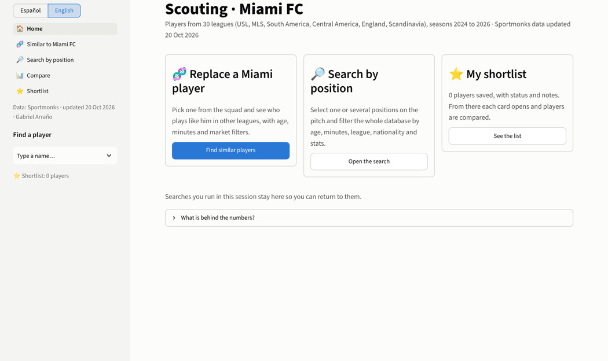
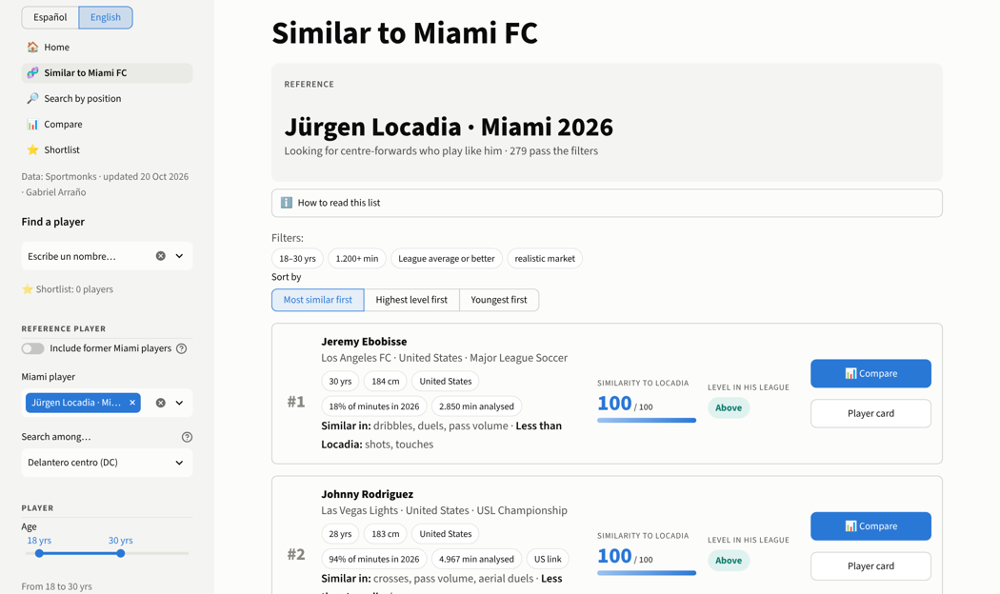
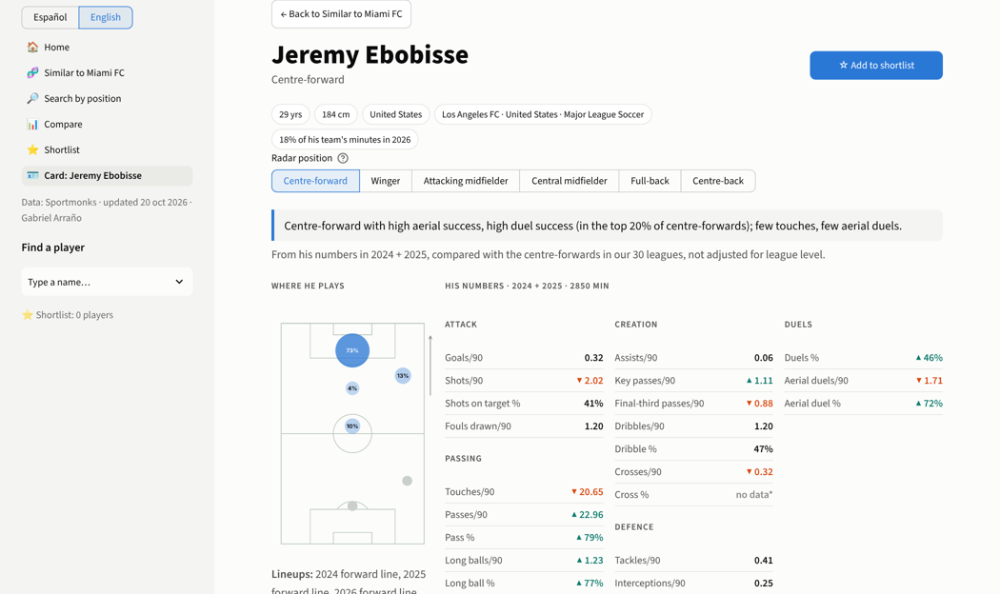
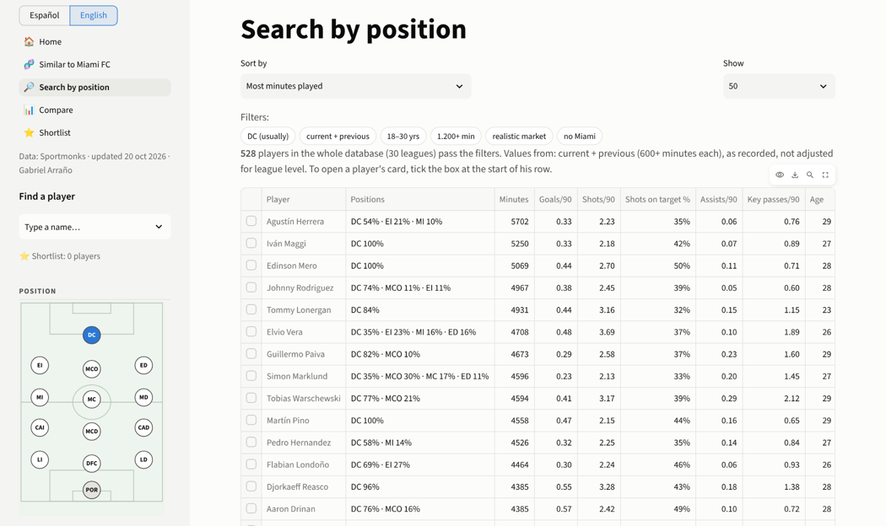
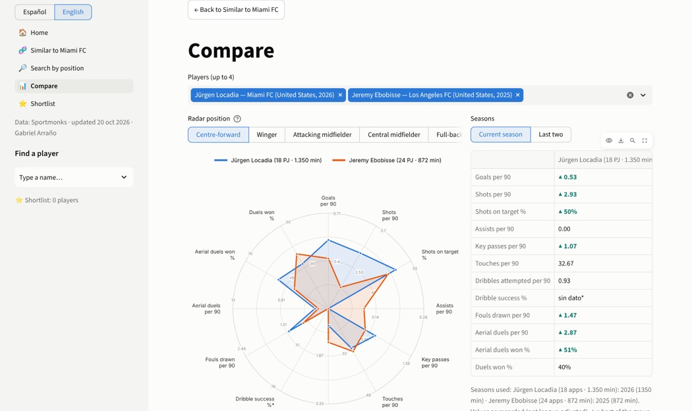

# USL Scouting Model

**Try it: [miamifc-scouting.streamlit.app/?lang=en](https://miamifc-scouting.streamlit.app/?lang=en)** (English; the staff use it in Spanish).
The first load after idle takes about 30 seconds while the database is prepared.

A recruitment tool built for the coaching staff of a USL Championship club, by its data analyst.
It answers one question a coach actually asks: **"who plays like this player, in a league we can sign from?"**

Code, method and validation are public. The data (Sportmonks, licensed) is not included, so the app does not run
from this repository alone; the screenshots below show it running on the full database.

The staff's language is Spanish, so that is the default. An English mode (`?lang=en`, or the switch in the sidebar)
translates the whole interface at render time (`scouting/i18n.py`), leaving the Spanish version untouched.



## What it does

| Page | What the coach gets |
|---|---|
| **Parecidos a Miami FC** | Pick one of our players; get the players in 30 leagues whose *style* is closest, with a 0–100 similarity, a level-in-his-league label, and a plain-language line: *"Se parece en: remates, duelos aéreos · Menos que Locadia: regates"*. |
| **Buscar por posición** | A Football Manager-style pitch: click one or several positions; the search uses **where each player actually started** (lineup slots), not his listed position. Filters in plain words (age, minutes, level, market, league, club, nationality). |
| **Ficha** | One-sentence profile from his percentiles ("Delantero centro con muchos remates…"), every stat vs the position, where he plays, radar vs our player, similar players, season history. |
| **Comparar** | Up to four players on a fixed-scale position radar; one-click PNG/PDF report. |
| **Lista corta** | Status (*por ver / visto / descartado*) and notes; persisted to a Google Sheet when configured. |






## Data

- **Sportmonks** player-match statistics: 30 leagues × 3 seasons (2024–2026), ~26,000 matches, ~55,000
  player-season rows, 23,000 players. USL Championship, USL League One, MLS, MLS Next Pro, Canada, Mexico (Expansión),
  Central America, South America, England League One/Two, Scandinavia, Ireland.
- Loaded into PostgreSQL by `scouting/sportmonks_ingest.py` (resumable, one transaction per match), summarised to one
  row per player-season-team by `scouting/sm_features.py`.
- Lineup slots (`formation_field`) → FM-style positions in `scouting/sm_slots.py`: the convention was checked
  against listed full-backs (home teams are mirrored; 9,900 of 10,200 home left-back starts land in the expected column).
- Known gaps are surfaced, not hidden: Sportmonks omits zeros, so a stat a league doesn't track looks like 0 for
  everyone. `radar.tracked_seasons()` treats a league-season with a zero total as *not measured* and the app shows
  "sin dato\*" instead of a number. MLS Next Pro is missing matches versus Wyscout and is flagged on every card.

## Method

**Features** (`sm_metrics.py`): per-90 volumes, success rates, and possession-adjusted defensive volumes
(opponent touches while he was on the pitch, so a centre-back in a possession team isn't punished for making fewer tackles).

**Which stats to trust** (`stability.py`): for every position, the season-to-season test–retest correlation of each
stat among players with 600+ minutes in both seasons, with bootstrap CIs. Only stats with *r* ≥ 0.4 enter the
similarity model, weighted by *r*. Goals, for instance, barely make the cut; shot volume and aerial duels do.

**Profiles** (`fit.py`): z-scores **within league-season and position** (a striker is compared with the strikers of
his own league), minutes-weighted over his last two usable seasons, and shrunk toward the position mean by
Spearman–Brown reliability at his minutes, so a 700-minute season can't look like a 2,500-minute one.
Similarity = weighted distance to the reference profile, reported as a percentile among all players of the position.
"Level" = the weighted mean of his success-rate z-scores. The `profiles()` step is vectorised (0.8 s for 1,600 strikers).

**Position from the numbers** (`position_model.py`): multinomial logistic regression on the z-scores.
Cross-validated by player (GroupKFold): **81% accuracy, 93% with the second choice** (`output/position_model_cv.json`).

**Realistic market** (`market.py`): drops established starters (≥50% of starts in their latest season) at clubs in
stronger leagues; keeps the fringe players, who are the ones who actually move down.

**What transfers to the USL** (`translation.py`, `backtest.py`): from players who moved into the USL, per-stat league
factors corrected for regression to the mean (fitted on players who *stayed*), with leave-one-out validation.
Backtest on 45 movers from 9 leagues: predictions beat "same as last season" on 18 of 23 stats; 80% intervals covered
81% of outcomes. The same analysis shows pass accuracy and volume carry over (r ≈ 0.9 / 0.75) while goals and shots
don't, which is why the app says explicitly that raw values are **not** adjusted for league level.

## Design choices for a coaching audience

- Every filter says in words what it does ("De 18 a 30 años", "≈ 13 partidos completos"), and the active filters are
  summarised as chips above the results.
- Similarity is explained per candidate (which stats match, which don't), not just scored.
- Fixed radar scales per position (5th–95th percentile of the position) so a player looks the same whoever he is
  compared with; colour-blind-safe teal/orange with ▲▼ glyphs; blue is always *our* player, in the app and the PDF.
- Spanish throughout for the staff, including country and league names (`es_names.py`); full English mode for
  everyone else, without a second copy of the code.
- Honest uncertainty: sample-size warnings for low-minute references, "sin dato\*" markers, a data date on every page.

## Layout

```
scouting/
  app_v2.py            Streamlit app (pages: Inicio, Buscar, Parecidos, Ficha, Comparar, Lista corta)
  fit.py               profiles, similarity ranking, filters
  stability.py         test-retest reliability per stat and position → output/stability_*.csv
  position_model.py    position classifier (+ saved CV accuracy)
  market.py            realistic-market rule
  translation.py       league factors and level transfer into the USL
  backtest.py          leave-one-out backtest of the translation
  radar.py / export.py radars with fixed scales; PNG/PDF one-pager
  sm_features.py       Sportmonks rows → player-season-team table (data-quality rules documented in the file)
  sm_metrics.py        features and position groups
  sm_slots.py          lineup slots → FM positions
  sm_nationality.py / sm_us_eligible.py   nationality and US-link flags
  sportmonks_ingest.py API → PostgreSQL (resumable)
  es_names.py          Spanish display names
  i18n.py              English mode (render-time translation of every Streamlit text call)
  shortlist_store.py   shortlist persistence (Google Sheet or local JSON)
database/
  migrations/004_sportmonks.sql, 005_sm_us_link.sql   the sm_* tables
  ingest/db.py         connection helper
```

## Running it

Needs a Sportmonks token and a PostgreSQL database; neither is included.

```
export SPORTMONKS_TOKEN=...          # never in code
python scouting/sportmonks_ingest.py --all --seasons 3
python scouting/sm_features.py && python scouting/sm_slots.py && python scouting/sm_nationality.py
python scouting/stability.py && python scouting/position_model.py
python -m streamlit run scouting/app_v2.py
```

## Author

Gabriel Arraño · Data Analyst, Miami FC (USL Championship) · M.S. Data Science, University of Miami
· [linkedin.com/in/gabriel-arrano](https://linkedin.com/in/gabriel-arrano)
